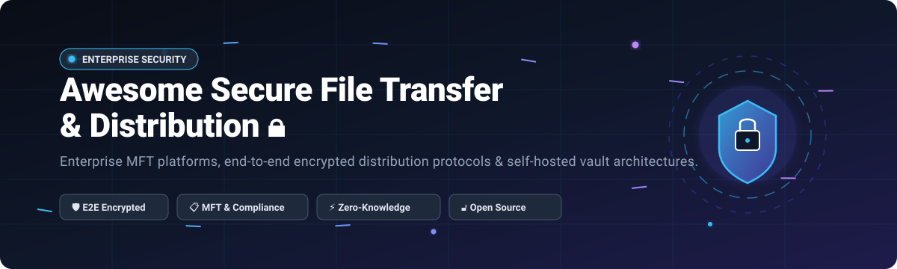

# 🔐 Awesome Secure File Transfer & Distribution 🚀

> A curated directory of top-tier **Secure File Transfer & Distribution (MFT)** platforms — enterprise SaaS/hosted solutions and community-vetted open-source tools for exchanging confidential, high-volume files with end-to-end encryption, tamper-evident audit trails, and strict compliance controls (PCI-DSS, HIPAA, GDPR, SOC 2).

  
  
  
  
  
  
  

🌟 **Star this repository if you find it valuable!** 🌟

---

## 📑 Table of Contents

- [🌐 Sector Overview & Market Dynamics](#-sector-overview--market-dynamics)
- [☁️ SaaS & Hosted Commercial Platforms](#️-saas--hosted-commercial-platforms)
- [💻 Open-Source Software & Self-Hosted Solutions](#-open-source-software--self-hosted-solutions)
- [🔍 Technical Feature Matrix & Protocol Comparison](#-technical-feature-matrix--protocol-comparison)
- [📈 Star History](#-star-history)
- [🤝 Contributing](#-contributing)
- [💖 Support & Sponsorship](#-support--sponsorship)
- [📄 License](#-license)

---

## 🌐 Sector Overview & Market Dynamics

The global **Secure File Transfer (SFT) & Managed File Transfer (MFT)** market is valued at approximately **$5.2 Billion in 2025** (with dedicated MFT software accounting for ~$2.3B) and is projected to expand to **$5.69 Billion by 2026** at an annual compound growth rate (CAGR) of 8.0%. The sector demonstrates a **moderately concentrated, consolidating oligopoly** at the enterprise tier dominated by legacy infrastructure incumbents (Citrix/Cloud Software Group, Progress Software, Axway, IBM), counterbalanced by a **fragmented periphery** of agile SaaS challengers and open-source zero-trust protocols addressing modern API automation, client-side encryption, and strict data sovereignty mandates.

---

## ☁️ SaaS & Hosted Commercial Platforms

Commercial, enterprise-grade cloud and hybrid Managed File Transfer (MFT) suites. Platforms below are **sorted in descending order by parent company scale (valuation / annual revenue)**.

| Platform | Company Valuation / Revenue 🏢 | Pricing (Starting Tier) 💵 | Free Tier / Trial Limits 🎁 | Key Protocols & Best For 🎯 |
|---|---|---|---|---|
| **[Citrix ShareFile](https://www.sharefile.com/)** | **~$16.5B Valuation** *(Parent: Cloud Software Group / ~$3.2B+ ARR)* | **$16.50 / user / month** billed annually (*Advanced Tier*, 3-user minimum = $49.50/mo) | **14-day free trial** (Evaluation access to Premium workflow and e-signature tools; requires business email) | SSL/TLS, AES-256, customer-managed storage zones (AWS/Azure/GCP/on-prem). Best for enterprise client collaboration and virtual data rooms. |
| **[Progress MOVEit](https://www.progress.com/moveit)** | **~$1.7B Market Cap** *(NASDAQ: PRGS / ~$998M ARR)* | **~$15,000 / year** (Base server license for *MOVEit Transfer* on-premises) or ~$140/user/yr cloud base | **30-day free trial** (Full-featured access to MOVEit Transfer and automation modules; no permanent free tier) | SFTP, FTPS, HTTPS, AS2. Best for high-volume automated enterprise workflows, tamper-evident audit logs, and PCI-DSS / HIPAA governance. |
| **[Axway SecureTransport](https://www.axway.com/en/products/managed-file-transfer/securetransport)** | **~$1.3B Valuation / €1.02B Market Cap** *(Euronext: AXW / ~€710M Revenue)* | **~$1,500 / month** (~$18,000 / year base entry tier subscription) | **Interactive live sandbox demo** (No permanent free tier; tailored 30-day enterprise PoC trial upon sales verification) | MFT gateway with high-availability active-active clustering, AS2, SFTP, PeSIT, REST API, AI MCP integration. Best for Fortune 500 financial and government data transfer. |
| **[Kiteworks](https://www.kiteworks.com/)** | **$1.0B Valuation** *(Unicorn status, $456M round / ~$130M ARR)* | **$15.00 / user / month** (Starting *Business Package*, 5-user minimum configuration) | **14-day free trial** (Up to 5 evaluation users with 1,000 GB secure file storage limit; no permanent free tier) | Hardened virtual appliance, vault-to-vault transfer, DLP/ATP integration, SIEM logging, NIST 800-53 / CMMC compliance. Best for security-hardened defense and healthcare vaults. |
| **[WeTransfer](https://wetransfer.com/)** | **~$760M Acquisition Valuation** *(Parent: Bending Spoons / ~$143M ARR)* | **$8.00 / month** ($7.00/mo billed annually for *Starter Tier*) | **Free forever plan** (Capped at 10 transfers or 3 GB total transfer volume per rolling 30 days; 3-day link auto-expiry) | Web HTTPS, TLS 1.3, AES-256 EU storage. Best for ad-hoc creative sharing, digital media delivery, and quick password-protected link distribution. |
| **[SendSafely](https://www.sendsafely.com/)** | **~$3.0M Revenue** *(Bootstrapped & privately held / ~15 employees)* | **$10.00 / month** (*Basic Tier* for individual and custom workflows) | **Free forever personal tier** (50 MB total transfer/month cap, 1 file per transfer) + **Pro Trial** (2 GB upload cap for evaluating dropzones/APIs) | Split-key end-to-end encryption (client-side AES-256), REST API, Node/Python/Java SDKs, Zendesk/Salesforce apps. Best for zero-knowledge helpdesk and CRM integration. |
| **[Titan MFT Server](https://titanftp.com/)** | **~$2.5M Revenue** *(South River Technologies / Privately held)* | **$65.70 / month** (Cloud VM on AWS/Azure) or ~$7,500 perpetual server license | **20-day free trial** (Unrestricted trial of all server automation events and protocol handlers) | SFTP, FTPS, WebDAV, HTTP/S, 100+ automation event triggers. Best for cost-conscious sysadmins requiring turnkey multi-protocol cloud servers. |

---

## 💻 Open-Source Software & Self-Hosted Solutions

Self-hosted, community-driven, and verifiable cryptographic file distribution engines. Listed below in **descending order by GitHub stargazers count**.

| Tool | GitHub_Stars 🌟 | Stack / Architecture ⚙️ | License 📜 | Description & Key Capabilities 💡 |
|---|---|---|---|---|
| **[LocalSend](https://github.com/localsend/localsend)** |  | Flutter / Dart / Rust | MIT | Open-source cross-platform alternative to AirDrop. Securely shares files, media, and text across local networks using HTTPS with custom TLS certificates and zero third-party internet dependencies. |
| **[Syncthing](https://github.com/syncthing/syncthing)** |  | Go / Web GUI | MPL-2.0 | Continuous, decentralized, and bidirectional file synchronization program. Employs the Block Exchange Protocol (BEP) over TLS with cryptographic node authentication and perfect forward secrecy. |
| **[croc](https://github.com/schollz/croc)** |  | Go / CLI | MIT | CLI file transfer tool designed for speed and simplicity. Provides end-to-end encryption via PAKE (Password Authenticated Key Exchange), NAT traversal/relays, resume interrupted transfers, and multi-file support. |
| **[Nextcloud Server](https://github.com/nextcloud/server)** |  | PHP / TypeScript / Vue | AGPL-3.0 | Self-hosted enterprise collaboration suite featuring encrypted file exchange, server-side and end-to-end file encryption modules, fine-grained access policies, full auditing, and DLP integration. |
| **[Magic Wormhole](https://github.com/magic-wormhole/magic-wormhole)** |  | Python / SPAKE2 | MIT | Cryptographic transfer utility that gets arbitrary files safely from one computer to another using human-pronounceable short codes. Uses SPAKE2 for authenticated key exchange and NaCl for encryption. |
| **[SFTPGo](https://github.com/drakkan/sftpgo)** |  | Go / REST API | AGPL-3.0 | Full-featured, modern Managed File Transfer server supporting SFTP, HTTP/S, FTP/S, and WebDAV. Features client-side encryption at rest, virtual folders, automated event triggers, and S3/Azure/GCS backends. |
| **[PairDrop](https://github.com/schlagmichdoch/PairDrop)** |  | Node.js / WebRTC / WebSockets | GPL-3.0 | Modern WebRTC-based browser file-sharing solution inspired by Apple AirDrop. Facilitates peer-to-peer encrypted data streams across local and public networks with temporary pairing codes. |
| **[Send (Fork of Firefox Send)](https://github.com/timvisee/send)** |  | Node.js / WebCrypto | MPL-2.0 | Maintained community fork of Mozilla's Firefox Send. Offers client-side AES-GCM encrypted file sharing with one-time download links, password protection, and custom expiration timers. |
| **[Palmr.](https://github.com/kyantech/Palmr)** |  | TypeScript / Next.js / Docker | MIT | Modern privacy-first file sharing platform. Features client-side encryption, time-based expiration, one-time download links, and self-hosted S3-compatible cloud storage integration. |
| **[PsiTransfer](https://github.com/psi-4ward/psitransfer)** |  | Node.js / JavaScript | BSD-2-Clause | Simple self-hosted open-source file sharing solution. Supports resume uploads, bucket downloads, client-side AES password encryption, custom retention duration, and zero tracking. |
| **[cryptgeon](https://github.com/cupcakearmy/cryptgeon)** |  | Rust / Svelte / WebCrypto | MIT | Lightweight, zero-knowledge note and file sharing service inspired by PrivNote. Encrypts files in the client browser with AES-GCM 256-bit keys before sending to server memory; auto-destructs after viewing. |
| **[FileSender](https://github.com/filesender/filesender)** |  | PHP / PostgreSQL / Docker | BSD-3-Clause | Production-grade large-file transfer platform developed by GÉANT for National Research and Education Networks (NRENs). Features SAML2 / OAuth SSO, terabyte-scale uploads, voucher invites, and modern v3.0 UI. |
| **[FiNo (pyfino)](https://github.com/arnispen/pyfino)** |  | Python / Nostr / IPFS | MIT / Research PoC | Experimental decentralized file exchange protocol combining AES-256-GCM encryption, IPFS content addressing, and Nostr Direct Messages (ECDH key exchange) without centralized relay infrastructure. |

---

## 🔍 Technical Feature Matrix & Protocol Comparison

| Solution | Deployment Model | End-to-End Encryption (E2EE) | Tamper-Evident Audit Trails | Multi-Cloud Storage | Compliance Scope | Recommended Operational Scenario |
|---|---|---|---|---|---|---|
| **Citrix ShareFile** | Hybrid Cloud | In-Transit & At-Rest (Customer Key) | ✅ Comprehensive SIEM logs | AWS S3, Azure, GCP, Local SAN | FINRA, HIPAA, SOC 2 | Enterprise business advisory, VDR, corporate collaboration |
| **Progress MOVEit** | Cloud & On-Premises | In-Transit & At-Rest (PGP / AES) | ✅ Tamper-evident cryptographic log | S3, Azure Blob, Local FS | PCI-DSS, HIPAA, GDPR, SOC 2 | Mission-critical B2B automated bulk batch processing |
| **Axway SecureTransport** | Cloud, Hybrid, On-Prem | In-Transit & Protocol Gateway | ✅ Full enterprise audit engine | Multi-Cloud & Hybrid Storage | GDPR, HIPAA, SOX, PCI-DSS | High-volume critical MFT cluster routing with 99.99% SLAs |
| **Kiteworks** | Hardened VM / Appliance | Vault-to-Vault Encryption | ✅ Standardized syslog & SIEM feed | Customer AWS/Azure/Private Cloud | FedRAMP, CMMC, ISO 27001, HIPAA | Defense industrial base and zero-trust private content networks |
| **WeTransfer** | Hosted Cloud (EU AWS) | In-Transit (TLS) & Rest (AES-256) | ⚠️ Basic sender download receipts | Hosted Cloud only | ISO 27001, GDPR | Quick ad-hoc digital assets and creative review links |
| **SendSafely** | Hosted Cloud | ✅ Split-key client-side E2EE | ✅ Comprehensive activity tracking | SendSafely Vault & Custom S3 | SOC 2 Type II, HIPAA, PCI-DSS | Zero-knowledge support desk ticket attachment intake |
| **Titan MFT** | Cloud VM & On-Prem | In-Transit & Rest (PGP / AES) | ✅ Event trigger & security logging | AWS S3, Azure Blob, Local Disk | HIPAA, PCI-DSS, Sarbanes-Oxley | Turnkey multi-protocol SFTP/WebDAV server replacement |
| **LocalSend** | Local P2P Network | ✅ TLS Peer-to-Peer Certificate | ❌ Not applicable (Ephemeral) | Device Local Storage | Local Network Privacy | Instant air-gapped file transfers across desktop & mobile |
| **Syncthing** | Distributed P2P Mesh | ✅ TLS + Perfect Forward Secrecy | ⚠️ Device operational event log | Local Storage on Peer Nodes | Data Sovereignty / Self-Host | Continuous decentralized synchronization across remote servers |
| **SFTPGo** | Self-Hosted Container/VM | Rest Encryption + TLS/SSH | ✅ JSON/syslog structured audit trails | S3, Azure, GCS, SFTP, WebDAV | GDPR, Self-governed controls | Modern API-driven multi-protocol file transfer backend |
| **Nextcloud** | Self-Hosted / Enterprise | ✅ Optional E2EE + Rest Encryption | ✅ Activity app & SIEM audit stream | S3, SMB/CIFS, WebDAV, Local FS | GDPR, HIPAA (with enterprise add-on) | Full sovereign private cloud replacing commercial Google Workspace / Box |
| **FileSender** | Self-Hosted NREN Cluster | Client-Side In-Browser AES (Optional)| ✅ Transfer voucher audit log | Local Storage / S3 Object Store | GDPR, Research Data Sovereignty | Academic & institutional multi-gigabyte research dataset transfers |

---

## 📈 Star History

---

## 🤝 Contributing

Contributions, software submissions, and improvements are warmly welcome! If you know of an enterprise-grade MFT solution or an open-source secure file distribution project that deserves inclusion:

1. 🍴 Fork this repository.
2. 🌿 Create a new feature branch (`git checkout -b feature/add-new-mft-tool`).
3. 📝 Add your tool in the relevant table adhering to formatting standards (specific pricing, exact trial limits, Stars_Badges, and verified protocols).
4. 🚀 Submit a Pull Request with a clear description and links.

Please refer to [Awesome-Awesome-Awesome](https://github.com/ishandutta2007/Awesome-Awesome-Awesome) for more curated tech stacks and awesome list collections.

---

## 💖 Support & Sponsorship

If this curated repository helped you assess, deploy, or secure your organization's file distribution architecture, please consider showing your support:

- ⭐ **Star this repository** to improve discoverability on GitHub.
- 🍴 **Fork and share** with fellow DevOps engineers, cybersecurity architects, and sysadmins.
- ☕ **Sponsor the maintainer** or buy a coffee via the official [GitHub Sponsor Dashboard](https://github.com/sponsors/ishandutta2007).

Your backing ensures these industry benchmarks and architectural guides remain actively maintained, accurate, and up to date! ✨

---

## 📄 License

This repository and curated list are made available under the [Creative Commons Zero v1.0 Universal (CC0 1.0)](https://creativecommons.org/publicdomain/zero/1.0/) public domain dedication. Software packages and services listed retain their respective corporate trademarks and copyright licenses.

  Maintained with ❤️ by <a href="https://github.com/ishandutta2007">Ishan Dutta</a> and community contributors.

